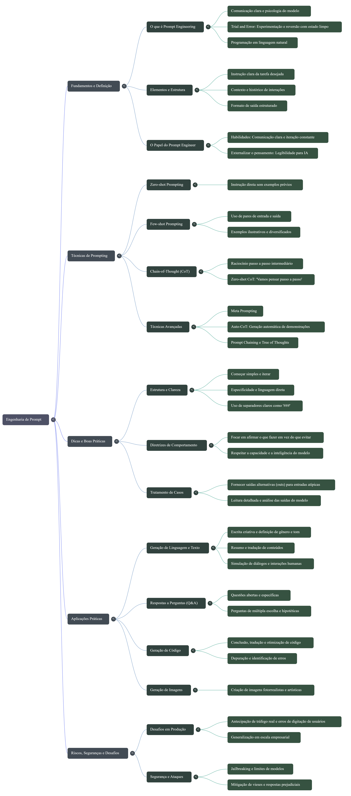

# 🧠 Segundo Cérebro: Engenharia de Prompt

Notebook especialista criado no **Gemini Notebook** (NotebookLM) para estudar **Engenharia de Prompt e uso de LLMs**, alimentado por fontes confiáveis em três formatos: **vídeos do YouTube, sites/documentação e PDFs acadêmicos**.

🔗 **Notebook compartilhado:** https://notebook.google.com/notebook/da9420f5-b4f6-4542-84a4-2f421558b310

---

## 1. Tema e objetivo

> **Objetivo:** "Quero um segundo cérebro que me ensine a escrever prompts melhores para LLMs, entendendo as técnicas principais (few-shot, chain-of-thought, system prompts), por que elas funcionam e quais os riscos de segurança (prompt injection e jailbreak), sempre com base em fontes oficiais e acadêmicas."

O que o notebook precisa saber:
- O que é engenharia de prompt e quais as boas práticas para escrever um prompt claro;
- Técnicas: zero-shot, few-shot, chain-of-thought;
- Como escrever uma mensagem de sistema (system prompt);
- Riscos: prompt injection, jailbreak e como se proteger.

## 2. Fontes que entraram (14) e por que confio nelas

**Critério de entrada:** só entra fonte **primária** (quem criou a técnica ou o modelo), **documentação oficial** de empresas que desenvolvem LLMs, ou **artigo acadêmico revisado/publicado**. Blogs genéricos, sites de SEO e resumos feitos por IA ficaram de fora.

### Fontes escolhidas por mim (8)

| # | Fonte | Formato | Por que confio |
|---|-------|---------|----------------|
| 1 | [AI prompt engineering: A deep dive — Anthropic](https://www.youtube.com/watch?v=T9aRN5JkmL8) | 🎥 Vídeo | Mesa-redonda com os engenheiros de prompt da Anthropic, empresa que cria o Claude |
| 2 | [[1hr Talk] Intro to Large Language Models — Andrej Karpathy](https://www.youtube.com/watch?v=zjkBMFhNj_g) | 🎥 Vídeo | Karpathy foi cofundador da OpenAI e diretor de IA da Tesla; explica LLMs e segurança (jailbreak/injection) |
| 3 | [Prompt engineering overview — Anthropic Docs](https://docs.claude.com/en/docs/build-with-claude/prompt-engineering/overview) | 🌐 Site | Documentação oficial de um fabricante de LLM |
| 4 | [Dicas gerais para projetar prompts — Prompt Engineering Guide (DAIR.AI)](https://www.promptingguide.ai/pt/introduction/tips) | 🌐 Site (PT-BR) | Guia aberto e muito citado, mantido pela DAIR.AI, com referências aos artigos originais |
| 5 | [Chain-of-Thought Prompting — Prompt Engineering Guide](https://www.promptingguide.ai/techniques/cot) | 🌐 Site | Mesmo guia, página específica da técnica CoT |
| 6 | [Prompt Engineering for AI Guide — Google](https://developers.google.com/machine-learning/resources/prompt-eng) | 🌐 Site | Guia oficial do Google |
| 7 | [Chain-of-Thought Prompting Elicits Reasoning in LLMs — Wei et al., 2022](https://arxiv.org/pdf/2201.11903) | 📄 PDF | Artigo original que criou a técnica CoT (Google Research, NeurIPS 2022) |
| 8 | [The Prompt Report: A Systematic Survey of Prompting Techniques — Schulhoff et al., 2024](https://arxiv.org/pdf/2406.06608) | 📄 PDF | Revisão sistemática acadêmica com a taxonomia de técnicas de prompting e segurança |

### Fontes encontradas pelo Deep Research e conferidas por mim (6 de 24)

O Deep Research achou **24 fontes**. Eu revisei a lista e **importei só 6**. Descartei blogs do Medium, guias de "2026" sem autoria clara, resumos gerados por IA e as duplicatas (ex.: 6 cópias diferentes do mesmo artigo DSPy). Também não importei o relatório gerado pela própria IA.

| # | Fonte | Por que entrou |
|---|-------|----------------|
| 9 | Best practices for prompt engineering with the OpenAI API (OpenAI Help Center) | Documentação oficial da OpenAI |
| 10 | System message design for Azure OpenAI (Microsoft Foundry / Learn) | Documentação oficial da Microsoft sobre system prompts |
| 11 | Safety system messages (Microsoft Foundry / Learn) | Documentação oficial da Microsoft sobre regras de segurança em system prompts |
| 12 | [DSPy: Compiling Declarative Language Model Calls… — arXiv 2310.03714](https://arxiv.org/abs/2310.03714) | Artigo acadêmico original (Stanford) |
| 13 | Large Language Models are Zero-Shot Reasoners — Kojima et al. (alphaXiv) | Artigo original do "Vamos pensar passo a passo" (zero-shot CoT) |
| 14 | Rethinking the Role of Demonstrations: What Makes In-Context Learning Work? — ACL Anthology | Artigo publicado na EMNLP 2022 sobre few-shot |

📸 Curadoria do Deep Research (24 encontradas → 6 selecionadas): [`prints/00-deep-research-curadoria.png`](prints/00-deep-research-curadoria.png)

## 3. Diretriz de comportamento dada ao notebook

Configurada em **Configurar as conversas → Personalizado**:

> Comporte-se como um especialista em engenharia de prompt e modelos de linguagem (LLMs), atuando como professor para um estudante iniciante. Responda sempre em português do Brasil, de forma didática e com exemplos práticos de prompts. Baseie-se exclusivamente nas fontes do notebook e cite a fonte de cada afirmação. Quando as fontes divergirem, compare os pontos de vista. Se a resposta não estiver nas fontes, diga isso claramente em vez de inventar.

## 4. Perguntas feitas, respostas e fontes citadas

### Pergunta 1: O que é chain-of-thought, por que melhora o raciocínio e quando usar?

**Resposta (resumo):** CoT faz o modelo escrever passos intermediários de raciocínio antes da resposta final. Existe em duas versões: *few-shot CoT*, com exemplos resolvidos, e *zero-shot CoT*, que só acrescenta "Vamos pensar passo a passo". Funciona porque decompõe o problema e dá ao modelo mais tokens de "computação". Os testes de ablação mostram que o raciocínio precisa vir **antes** da resposta: pedir a explicação depois, ou só gerar pontos de pausa, não traz o mesmo ganho. É uma **habilidade emergente da escala**: funciona bem em modelos grandes (~100B+ parâmetros) e pode piorar modelos pequenos. Vale a pena em matemática, senso comum e raciocínio simbólico. Não compensa em tarefas de 1–2 passos ou quando latência e custo são críticos.

**Fontes citadas pelo notebook:**
- `arxiv.org/pdf/2201.11903` (Wei et al.): definição, ablação "variable compute only" e "reasoning after answer", resultados por escala, exemplo do Roger e das bolas de tênis;
- *Chain-of-Thought Prompting | Prompt Engineering Guide*: zero-shot CoT e exemplo das maçãs;
- *AI prompt engineering: A deep dive* (vídeo Anthropic): debate se o modelo "raciocina de verdade";
- `arxiv.org/pdf/2406.06608` (The Prompt Report): uso de CoT em agentes (ReAct).

📸 [`prints/01-cot-citacao-arxiv.png`](prints/01-cot-citacao-arxiv.png): citação aberta mostrando o trecho do PDF do arXiv
📸 [`prints/02-cot-citacao-video-anthropic.png`](prints/02-cot-citacao-video-anthropic.png): citação apontando para a transcrição do vídeo da Anthropic

### Pergunta 2: Boas práticas para um prompt claro, comparando Anthropic, Google e Prompt Engineering Guide

**Resposta (resumo):** seja específico (público, extensão, formato), dê todo o contexto, diga o que **fazer** em vez do que não fazer, use exemplos (few-shot), use delimitadores (`###`, XML), dê uma "saída" para casos ambíguos e use o próprio modelo para revisar o prompt (meta-prompting).
- **Concordam:** clareza e especificidade; processo iterativo; contexto e exemplos; decompor tarefas complexas.
- **Divergem em personas:** Google e Prompt Engineering Guide recomendam atribuir papéis ("Você é um..."). Os especialistas da Anthropic são mais críticos: preferem descrever a situação real e tratar o modelo como alguém competente que não conhece o seu contexto.

**Fontes citadas:** *AI prompt engineering: A deep dive* (Anthropic), *Prompt Engineering for AI Guide* (Google), *Dicas gerais para projetar prompts* (Prompt Engineering Guide), `arxiv.org/pdf/2406.06608` (role prompting).

📸 [`prints/03-comparacao-fontes-personas.png`](prints/03-comparacao-fontes-personas.png): tabela comparativa com a citação do vídeo da Anthropic sobre personas

### Pergunta 3: O que é prompt injection e jailbreak, e que cuidados ter?

**Resposta (resumo):**
- **Prompt injection:** uma entrada maliciosa sobrepõe as instruções do desenvolvedor, porque o modelo não separa nativamente "instrução" de "dado". Também existe a versão **indireta**, com instruções escondidas em páginas, documentos ou e-mails.
- **Jailbreak:** burla as travas de segurança do próprio modelo. Técnicas comuns: roleplay (o exemplo da "avó"), texto em Base64, sufixos adversariais e ruído em imagens.

**Cuidados:** separar instruções e dados com delimitadores; usar guardrails e detectores externos; limitar ferramentas de agentes e manter um humano no loop; atenção à "alucinação de pacotes"; fazer red teaming.

**Fontes citadas:** `arxiv.org/pdf/2406.06608` (definições, defesas, package hallucination), *[1hr Talk] Intro to Large Language Models* (Karpathy: exemplos de jailbreak, Base64, sufixos, injeção indireta), *Prompt Engineering Guide* (delimitadores), *AI prompt engineering: A deep dive* (testes com tráfego real).

📸 [`prints/04-seguranca-citacao-video-karpathy.png`](prints/04-seguranca-citacao-video-karpathy.png): citação abrindo a transcrição do vídeo do Karpathy sobre Base64

### Pergunta 4 (depois de importar o Deep Research): Como escrever um bom system prompt com regras de segurança?

**Resposta (resumo):** um bom system prompt tem 5 blocos:
1. Papel e tarefa;
2. Escopo e limites;
3. Política de incerteza (o que responder quando não souber);
4. Diretrizes de segurança (inclusive ignorar tentativas de prompt injection);
5. Formato e tom.

O notebook gerou um **modelo pronto** em Markdown com essas seções. Também comparou as fontes: a Microsoft sugere combinar regras positivas (Always), condicionais (If…then) e proibições (Never), enquanto a OpenAI e o Prompt Engineering Guide preferem instruções positivas.

**Fontes citadas:** *Safety system messages* e *System message design for Azure OpenAI* (Microsoft, ambas importadas pelo Deep Research), *Best practices for prompt engineering with the OpenAI API*, *AI prompt engineering: A deep dive* (Anthropic).

📸 [`prints/05-system-prompt-citacao-microsoft.png`](prints/05-system-prompt-citacao-microsoft.png): citação mostrando a fonte da Microsoft importada pelo Deep Research

## 5. Materiais gerados no Estúdio

| Material | Arquivo |
|----------|---------|
| 🗺️ Mapa mental (expandido) | [`materiais/mapa-mental.png`](materiais/mapa-mental.png) |
| 📊 Apresentação de slides | [`materiais/slides.pdf`](materiais/slides.pdf) |



## 6. Aprendizados

- O notebook **sempre** respondeu com citações numeradas, e cada número abre o trecho exato da fonte (página do PDF ou parte da transcrição do vídeo).
- Ter fontes de "escolas" diferentes deixou a resposta mais rica. O melhor exemplo é o debate sobre usar personas: Google e DAIR.AI defendem, os especialistas da Anthropic são críticos.
- O Deep Research ajuda, mas trouxe muito lixo: duplicatas, blogs e resumos de IA. Só 6 das 24 fontes passaram no meu critério.
- Misturar uma fonte em português (Prompt Engineering Guide PT-BR) com fontes em inglês funcionou bem: as respostas saíram em português, citando os trechos originais em inglês.

## Estrutura do repositório

```
├── README.md
├── materiais/
│   ├── mapa-mental.png
│   └── slides.pdf
└── prints/
    ├── 00-deep-research-curadoria.png
    ├── 01-cot-citacao-arxiv.png
    ├── 02-cot-citacao-video-anthropic.png
    ├── 03-comparacao-fontes-personas.png
    ├── 04-seguranca-citacao-video-karpathy.png
    └── 05-system-prompt-citacao-microsoft.png
```
